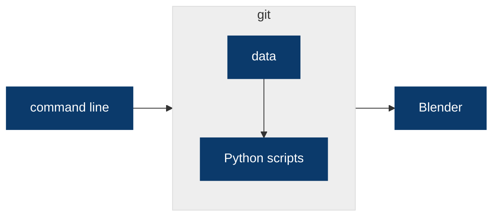

<!-- .slide: data-state="title" -->

# Blendercon 2026

Analytics and Visualization SIG

 

Djura Smits | 20 October 2026

===

<!-- .slide: data-state="standard" -->

## Blender

Open source software for:

- 3D modeling/sculpting
- Animation
- Video editing
- Scripting in Python
- Thriving community of plugin developers

---

<!-- .slide: data-state="standard" -->

## Blendercon

- Heart of Amsterdam
- 3 days
- 700+ attendees
- 126 speakers

---

<!-- .slide: data-state="standard" -->

## My question

- What kind of scientific applications does Blender have?
- What are the pros (and cons) of using Blender for scientific visualization?
- Is Blender worth recommending despite the steep learning curve?

---

<!-- .slide: data-state="two-pane" -->

## Spoiler Alert: Blender is worth learning!

Scientific Visualization Meetup: Gabriele Meilikhov, Muza Productions

There are a lot of excited scientific Blender users out there! ([Sciviz Meetup](https://conference.blender.org/2026/presentations/4229/))

---

<!-- .slide: data-state="standard" -->

## Ways Blender is used for science

1. Data storytelling with cinematic quality
2. Blender as a simulation hub
3. Add-ons that borrow Blender's 3D tools
4. Making data representation accurate

===

<!-- .slide: data-state="title" -->

# 1. Data storytelling with cinematic quality

---

<!-- .slide: data-state="standard" -->

## SciGraphs ([link](https://conference.blender.org/2026/presentations/4165/))

José Marín · CoMMLab (Universitat de València) / SciBlend

- Plenty of tools for graph analysis, but not for graph animation
- Animation as a craft is missing: curves, ease, camera, light
- SciGraphs: graph analysis + filmmaking, built on Geometry Nodes

Note:
José Marín (CoMMLab, Universitat de València / SciBlend). Quote from the talk: "Graph animation lives in tools built for analysis. Film-making lives in tools that have never heard of a graph." Layouts, centrality, communities, geospatial graphs. Open source, installable from Blender Extensions (github.com/SciBlend/SciGraphs).

---

<!-- .slide: data-state="standard" -->

### SciGraphs in action

<video class="video" src="./videos/scigraphs-render-demo.mp4" controls muted preload="metadata"></video>

Note:
Render demo of SciGraphs. In this case, main point of addon is art.

---

<!-- .slide: data-state="standard" -->

## Collaborating in .blend files ([link](https://conference.blender.org/2026/presentations/4200/))

Neele Dijkstra, Torben Hanegraaf, Jop van Roosmalen et al. · Rijkswaterstaat

- Rijkswaterstaat made a film about the Dutch rivers
- Contributions from many teams: tides, wind, an accurate GIS map, camera work
- Everyone working directly in one .blend file got chaotic

Note:
Rijkswaterstaat (Neele Dijkstra, Torben Hanegraaf, Jop van Roosmalen, with Casper Vissers and Blooming Data). A sea-tide animation, a 2D wind animation, an accurate GIS map and the camera work all came from different people. Having that many collaborators work directly in Blender quickly became chaotic.

---

<!-- .slide: data-state="two-pane" -->

### Solution: collaborate in git

- The whole scene is written in Python, including adding objects
- Blender runs from that code
- The .blend file is never saved
- Data and scripts live together in Git

---

<!-- .slide: data-state="standard" -->

### Their result

<video class="video" src="https://www.rovid.nl/ienw/rws/2026/ienw-rws-20260729-id1s1rkmwu-web.mp4" controls muted preload="metadata"></video>

[rijkswaterstaat.nl/water/waterbeheer](https://www.rijkswaterstaat.nl/water/waterbeheer)

Note:
Play the film here. The video was made entirely with this code-and-Git workflow.

---

<!-- .slide: data-state="image-below" -->

### Caveat: node trees as bpy code are verbose

  
  

Note: Next talk provides a solution to this verbosity problem.

---

<!-- .slide: data-state="standard" -->

## nodebpy: Node trees as code:  ([link](https://conference.blender.org/2026/presentations/4257/))

Brady Johnston · Molecular Nodes

- Increasingly more assets are becoming node trees
- Increased interest in code-first workflows because of AI agents
- raw bpy code is verbose and hard to read
- Bpy code is stringly-typed

Note:
Brady Johnston, who created Molecular Nodes

---

### [Nodebpy](https://bradyajohnston.github.io/nodebpy/)
- Makes code-first workflows more readable and maintainable
- Node trees are represented as Python objects, not bpy calls
- Creator has a great track record of maintaining open-source Blender add-ons 
    ([Molecular Nodes](https://bradyajohnston.github.io/MolecularNodes/))

===

<!-- .slide: data-state="title" -->

# 2. Blender as a simulation hub

---

<!-- .slide: data-state="image-below" -->

## Blender brings together simulations

---

<!-- .slide: data-state="two-pane" -->

## Procedural simulation environments ([link](https://conference.blender.org/2026/presentations/4184/))

Felipe Oliveira Ribas · Ghent University

- Sionna RT is an open-source library for simulating radio propagation
- Jupyter notebook can be used to simulate
- Jupyter is not sufficient for more complex scenes

Note: "Building Procedural Simulation Environments" by Felipe Oliveira Ribas. Ray-tracing simulations are getting 
faster, but the 3D environments are still often static, simplified and prepared by hand for one scenario. Blender becomes a procedural scene-generation layer: Geometry Nodes and Python create controlled scene variations, expose geometric assumptions, and generate different levels of detail for different computational budgets. EM propagation is one example (procedural greenhouses, plants at any growth stage, heatmap shown in the 3D scene). Main point: Blender can connect different simulations into one tool. (The Sionna RT description is background knowledge, not from the talk: check it.)

---

<!-- .slide: data-state="image-below" -->

## Easy generation and variation of scenes

---

<!-- .slide: data-state="image-below" -->

## Application: Tracking EM waves through Greenhouses

---

<!-- .slide: data-state="two-pane" -->

## Stellar evolution([link](https://conference.blender.org/2026/presentations/4202/))

Ben de Vries · SURF

- TULIPS-3D: MESA computes the physics
- Science data is converted to textures
- Scrub through a star's interior over time
- Mass transfer in binary systems, made visible

Note:
Eva Laplace and Ben de Vries (SURF / UvA / KU Leuven). Stellar evolution is usually shown as tracks on a Hertzsprung-Russell diagram: accurate but abstract. TULIPS-3D is a Blender add-on, successor to the 2D TULIPS visualisation, still under construction and open source. Their claim: the first visualisation where you can intuitively see mass transfer happen in binary star systems.

---

<!-- .slide: data-state="standard" -->

## Animals in motion ([link](https://conference.blender.org/2026/presentations/4240/))

Shravan Tata Ramalingasetty · Janelia Research Campus

- [FARMS](https://doi.org/10.1101/2023.09.25.559130) is a simulation tool for neuromechanical modeling
- Tight integration of muscle and neural models
- animal/robot-agnostic

Note:
Shravan Tata Ramalingasetty (Janelia Research Campus). Example: a mouse walking over uneven terrain, driven by a model of its spinal circuitry. Open source as FARMS (Framework for Animal and Robot Modeling and Simulation), with a custom Blender add-on. UPBGE, a fork that keeps the Blender Game Engine alive, also came up for real-time simulation.

---

<!-- .slide: data-state="two-pane" -->

### How do they use FARMS?
1. Full CT scan of animal, e.g. a mouse 
2. Organs and muscles segmented with AI
3. Rigged in Blender, then simulated walking

Note: The red bars indicate pressure strength. This data feeds back into the neural model, which in turn drives the 
muscles.

---

<!-- .slide: data-state="image-below" -->

## Sensory feedback closes the loop

Note:
Still from the talk (Shravan Tata Ramalingasetty, BCON26). Left: the spinal circuitry model. Middle: the mouse walking over uneven terrain, with ground contact and pressure sensed at the feet. Right: the sensory feedback circuit and the hindlimb muscles. Contact feedback goes into the neural model, which drives the muscles.

===

<!-- .slide: data-state="title" -->

# 3. Add-ons that borrow Blender's 3D tools

---

<!-- .slide: data-state="standard" -->

## Why build an add-on?

- Blender has powerful 3D manipulation and navigation
- These are difficult to implement in a custom tool
- Scientists add their own data types and workflows on top

Note:
A recurring pattern: scientists build their own add-on so Blender understands their data, instead of building a 3D viewer from scratch.

---

<!-- .slide: data-state="two-pane" -->

## Gaussian splatting ([link](https://conference.blender.org/2026/presentations/4214/))

Sören Schmidt-Clausen · Freelance technical artist

- Photoreal 3D scenes reconstructed from photos
- In my experience: splat tools are painful to navigate and clean up
- Blender has modeling and navigation built in
- BlendSplat: import splats, edit with Geometry Nodes

Note:
"Procedural Workflows with Gaussian Splatting". Gaussian splatting (3DGS) reconstructs photoreal 3D scenes from photos. A lab, a field site or an artefact can be placed in the same scene as the scientific data. The talk itself is mostly about artistic uses (clouds, relighting, rigging), but the points carry over to science. Main point: Blender brings together multiple data types in one scene (splats, meshes, volumes, measurement data), and its modeling and navigation tools are built in. Dedicated splatting tools are annoying to navigate and clean up. Image: still from the talk (Sören Schmidt-Clausen, BCON26), a splat in the Blender viewport with Geometry Nodes.

---

<!-- .slide: data-state="two-pane" -->

## SciExplorer: microscopy data ([link](https://conference.blender.org/2026/presentations/4215/))

SciExplorer: Alisa Ovsiannikova, Maastricht University / ETH Zürich Cella: Sampo Muranen, Umeå Plant Science Centre

- Links objects from microscopy data to their measurements
- Filter and inspect structures in 3D
- Also: [Cella](https://conference.blender.org/2026/presentations/4127/), for plant single-cell transcriptomics

Note:
Researchers can filter and inspect structures in 3D. Cella paper: onlinelibrary.wiley.com/doi/full/10.1111/ppl.14068.

---

<!-- .slide: data-state="standard" -->

## Accident visualization

- Not a talk: a conversation at the conference
- Crime scene and accident reconstruction
- Attorneys want Blender's output, not its interface
- Solution: plugins that simplify Blender for them

Note:
I talked to Holly, who does crime scene reconstruction. It is hard for attorneys to interact with Blender, but they do want what it provides. She built plugins to simplify the interface. Related ideas from the Sciviz meetup: application templates, export to glTF or Sketchfab, straight to the browser.

===

<!-- .slide: data-state="title" -->

# 4. Making it accurate

---

<!-- .slide: data-state="two-pane" -->

## Scientific data on surfaces ([link](https://conference.blender.org/2026/presentations/4293/))

Nicole Feng · geometry processing researcher

- Starts in her own geometry processing tools
- Exports to Blender, which she uses extensively for figures in papers
- The data travels with the surface, packed into the mesh UVs

Note:
Her specialty is geometric computing (meshes, curves, point clouds), so the computation happens in her own tools. She then exports the mesh with the values packed into the UVs, and looks them up in a colormap image such as viridis in shader nodes (UV, Separate XYZ, image texture, BSDF). The image shows the workflow: experiment in Polyscope (her geometry processing viewer), export the mesh, pack the scalar data in the texture coordinates. She uses Blender a lot to render geometry for papers. nzfeng.github.io.

---

<!-- .slide: data-state="image-below" -->

## Figures from her geometry papers

  
  

Note:
Stills from Nicole Feng's talk (BCON26). Left: a wall of results from her research papers. Right: one of her fun illustrations, cows on a torus showing a fence that bounds a region versus one that does not. She uses Blender extensively to render geometry for her papers.

---

<!-- .slide: data-state="two-pane" -->

## Keeping the render accurate

- A pretty picture is not the same as a correct one
- Blender's defaults are tuned for pleasing images, not faithful ones
- The talk is full of tips to keep rendered values accurate

Note:
The image is her good-versus-bad comparison of color management: same data, same colormap, but the bad one no longer matches the legend. The audience does not need the details, but the talk has many concrete tips: color management set to Standard instead of AgX or Filmic (tone-mapping view transforms change the colormap, so the rendered colors no longer match the legend), an emission shader so the color is the data and not the lighting, and Fresnel to highlight small details and silhouettes. Accuracy is not the default in Blender.

===

<!-- .slide: data-state="title" -->

# Conclusion

---

<!-- .slide: data-state="standard" -->

## Why Blender for science?

- Mature 3d software with a lot of features
- Customisability: Python API and add-ons
- Reproducibility: scenes generated from code, versioned in Git
- Cinematic quality: cameras, light, materials, animation curves
- Free and open source
- A thriving community and ecosystem

---

<!-- .slide: data-state="standard" -->

## Talks

- [Co-Creating 3D Data Animations With Code](https://conference.blender.org/2026/presentations/4200/)
- [Build Your Node Trees With Code](https://conference.blender.org/2026/presentations/4257/)
- [From Stardust to Black Holes: Visualising the Physics of Stellar Evolution in Blender](https://conference.blender.org/2026/presentations/4202/)
- [Graph Visualization and Analysis with SciGraphs](https://conference.blender.org/2026/presentations/4165/)
- [Building Procedural Simulation Environments](https://conference.blender.org/2026/presentations/4184/)
- [Neuromechanical Modeling and Simulation of Animals and Robots](https://conference.blender.org/2026/presentations/4240/)
- [SciExplorer: From Microscopy Data to Interactive Scientific Visualisation](https://conference.blender.org/2026/presentations/4215/)
- [Cella: 3D Data Visualization for Plant Single-Cell Transcriptomics](https://conference.blender.org/2026/presentations/4127/)
- [Procedural Workflows with Gaussian Splatting](https://conference.blender.org/2026/presentations/4214/)
- [Scientific Data on Surfaces](https://conference.blender.org/2026/presentations/4293/)
- [Scientific Visualization Meetup: Tools, Trends, Community](https://conference.blender.org/2026/presentations/4229/)

---

<!-- .slide: data-state="two-pane" -->

## Thank you!

<model-viewer class="pane-model" src="./files/escience_donut.glb" alt="Animated eScience donut" autoplay camera-controls auto-rotate camera-orbit="0deg 75deg 190%" interaction-prompt="none" shadow-intensity="0" data-prevent-swipe></model-viewer>

Note:
Animated GLB exported from Blender. Drag to rotate it.
